> *Archived copy of the original report. The Google Doc is no longer available because the company account no longer exists. The text is unchanged. The specification files this report linked to were superseded when the design moved to Semaphore, so those links now point to the current documents.*

# ZK VOTING PROTOCOL

| Proof of Achievement |  |
|---|---|
| Proposal | 1200252 |
| Link | [Zero-Knowledge (zkSNARK) Voting Protocol on Cardano for DAO Governance](https://projectcatalyst.io/funds/12/f12-cardano-open-developers/zero-knowledge-zksnark-voting-protocol-on-cardano-for-dao-governance-open-source) |
| Milestone | 1 |
| Status | Approved - November 30th 2024 |
| Last Update | 8th November 2024 |
| Contributors | Dominik Tilman |
| Deliverables | ZK Voting DApp Design:   zk-SNARK Setup   Cryptographic Specifications   Protocol Layout for on-chain & off-chain processes:   Voter Registration & Anonymity   Voting Process   Vote Tallying and Verification   Off-chain calculations   System Architecture & Tech Stack   UI Design Mockups |
| Links | [docs/design/](../design/)   [https://trustlevel.gitbook.io/knowledge-base/](https://trustlevel.gitbook.io/knowledge-base/) |

## Overview

This document presents the design for our Zero-Knowledge Voting Protocol implemented as a decentralized application (DApp) on the Cardano blockchain. Our presented approach extends beyond the proposed protocol – we aim to deliver a fully functional, user-friendly DApp that brings privacy-preserving voting to the Cardano ecosystem.

**Scope and Flexibility:**

In the following sections, we have documented the complete system design, encompassing:

- Detailed user interaction flows
- Zero-knowledge proof implementation
- Cryptographic foundations
- On-chain and off-chain protocols
- System architecture
- User interface design

While our research and design choices reflect current best practices and thorough investigation, we want to acknowledge the rapidly evolving nature of zero-knowledge technology. The design maintains flexibility to incorporate emerging improvements, particularly:

- Midnight: Cardano’s privacy Sidechain offers great functionality for ZKPs but is only available in the Testnet at this moment. If progress is made here in time, this would be a great addition to the protocol!
- New Aiken libraries
- Advances in ZK-SNARK implementations on Cardano (see F12 proposal from AnastasiaLab: [https://projectcatalyst.io/funds/12/f12-cardano-open-developers/anastasia-labs-zk-accelerate-a-user-friendly-smart-contract-library-for-zk-contracts](https://projectcatalyst.io/funds/12/f12-cardano-open-developers/anastasia-labs-zk-accelerate-a-user-friendly-smart-contract-library-for-zk-contracts))

**Document Structure;**

Overview

M1 Documentation

Background

DApp User Flow

Step 1: Access the DApp & Connect Wallet

Step 2: Ballot creation

Step 3: Voting

Step 4: Tallying and Results

zkSNARK Setup

Cryptographic Specifications

Protocol Layouts

Cardano specific Considerations

High-Level On-chain data flow

First Iteration Implementation Strategy (Milestone 2)

System Architecture / Tech Stack

UI Mockups

## Milestone 1 Documentation

We created a new GitHub repository, where you find all mentioned documents: [docs/design/](../design/)

### Background

At its core, zk-SNARKs (Zero-Knowledge Succinct Non-Interactive Argument of Knowledge) allow someone to prove that they know something (e.g., a valid vote) without revealing any details about what they know (e.g., the actual vote). In our case, this is crucial for:

- Anonymity: Voters should be able to prove that they are eligible to vote without revealing who they are.
- Vote Validity: The system should ensure that the voter has cast only one valid vote without revealing which option they voted for.

**zk-SNARK Circuits**

A circuit is the logic that defines what the proof is validating. In a zk-SNARK system, you create a mathematical circuit that expresses a computation. In our case, the circuit will:

- Validate that the voter is eligible.
- Ensure the vote follows the rules.
- Maintain privacy (by not exposing the voter’s identity or their choice).
### DApp User Flow

**→ Complete DApp data flow is visualized here:**  
[docs/design/SYSTEM_DESIGN.md](../design/SYSTEM_DESIGN.md#data-flow)

#### Step 1: Access the DApp & Connect Wallet

- **User Visits the DApp URL**:
- **Process**: The user navigates to DApp’s URL.
- **Security**: The DApp should use HTTPS for secure data transmission, and the interface should prompt the user to verify the DApp’s authenticity (e.g., by checking the URL or certificate).
- **Prompt to Connect Wallet**:
- **User Prompt**: The DApp interface displays a “Connect Wallet” button, prompting the user to link their Cardano-compatible wallet (e.g., Lace, Yoroi, Daedalus).
- **Technical Interaction**: When the user clicks “Connect Wallet,” the DApp triggers a **wallet connection request** through the CIP-30 **dApp Connector API** for Cardano wallets.
- **Wallet Interface**: The wallet’s interface (e.g., a popup in a browser extension) appears, requesting the user to confirm the connection.
- **Connection Verification**:
- **Message Signing for Verification**:
  - The DApp requires the user to sign a message with their wallet to prove ownership of the address. This is a **non-transactional signature** that does not incur fees or record on the blockchain but verifies that the user controls the connected wallet.
  - The DApp provides a nonce/unique identifier as part of the message to prevent replay attacks.
  - This nonce is a random value that the DApp temporarily associates with the user’s session or action. It is unique to the user and session, ensuring that it cannot be reused.
- **Verification Steps**:
  - The user signs the message in their wallet, and the DApp verifies the signature to confirm the user’s identity.
- **Retrieve Wallet Address and Network Details**:
- The DApp retrieves the user’s **wallet address** and **network details** (e.g., Cardano mainnet or testnet).
- This allows the DApp to uniquely identify the user for the voting process without accessing sensitive wallet information.
- The DApp keeps the **wallet address** in the user’s session for the duration of their interaction. This allows the DApp to link subsequent actions (such as eligibility verification) to the user’s wallet without storing any private or sensitive data.
- This session data remains off-chain and is cleared after the user’s interaction ends.

*→ DID Generation and Association (Optional):*

- *If the DApp uses DIDs, consider introducing the DID generation or retrieval process here. Once the wallet connection is established and verified:*
- *Generate a DID based on the user’s wallet information (e.g., a hash derived from the wallet address and unique nonce).*
- *Associate the DID with the wallet session to use as a pseudonymous identifier, allowing the DApp to reference the user consistently without exposing the wallet address directly.*
- *This DID can then serve as the user’s primary identifier within the DApp, keeping the wallet address private for future interactions.*
#### Step 2: Ballot creation

- **Define Ballot Parameters**:
- **Ballot Title**: A unique name or title to identify the ballot (e.g., “Community Budget Allocation”).
- **Ballot Options**: The options or candidates available in the ballot (e.g., Project A, Project B).
- **Ballot Type**:
  - **Single-choice**: Users can select only one option.
  - **Multiple-choice**: Users can select more than one option.
  - **Weighted voting**: Users can distribute their vote across multiple options.
- **Voting Period**: Specify start and end times, defining when voting is open and closed.
- **Access Control**: Define which users or groups are eligible to participate in the ballot.
  - If no DIDs are available, the admin can create a unique access token per user.
  - If the DID is known, a list with all eligible DIDs can be created.
- **Ballot Registration on Chain**:
- **Submit Ballot Metadata**: Store essential ballot information, such as title, options, and start/end times, on-chain. This allows the DApp to verify the validity and timing of each ballot.
- **Generate Ballot ID**: Each ballot is assigned a unique ID for tracking and identification. This ID is referenced in vote commitments and proofs during the voting process.
- **Access Tokens**:
- Generate unique, non-replicable **access tokens** for each user or group eligible to participate in a ballot. Tokens are distributed off-chain but validated within the DApp.
- **Token-based Access**: When users try to access a ballot, they submit their token, which the DApp verifies before granting access.
- **Expiration and Revocation**: Tokens can expire automatically after the voting period or specific time window. The DApp should allow ballot creators to revoke tokens if needed, invalidating them immediately if access needs to be restricted.
- **Re-issuance**: If a user loses their token, provide a secure way for the DApp to re-issue a token, verifying eligibility before sending it again.
- **Revocation Log**: Keep an on-chain or off-chain log of revoked tokens, so users and admins can verify which tokens are still active. This improves transparency for users concerned about ballot security.
- **Tokenless Access with zk-SNARK Proofs**:
- Users with a DID can generate a **zk-SNARK proof of eligibility** when accessing each ballot, without the need for individual tokens.
#### Step 3: Voting

- **Access Ballot and Verify Eligibility**
- **Token Submission**:
  - When a user wants to participate in a ballot, they access the ballot and submit their **ballot-specific access token**. This token confirms they’re eligible to vote in the specific ballot.
- **Token Validation**:
  - The DApp verifies the token to ensure:
    - It’s valid for the specified ballot (matches ballot ID).
    - It’s authentic (signature or cryptographic check).
    - It hasn’t expired or been revoked.
- **Granting Access**:
  - If the token is valid, the DApp grants the user access to the voting interface for that ballot.
- **Selecting the Vote**
- **Vote Options Display**:
  - The DApp displays the ballot options (e.g., candidates or choices) according to the ballot parameters.
- **User Selection**:
  - The user makes their selection(s) according to the ballot type.
- **Vote Commitment Using Pedersen Commitments**
- The DApp uses a **Pedersen commitment** to secure the user’s vote. This process allows the vote to be **private (hidden)** and **binding (unchangeable)**.
- **Commitment Formula**: The commitment  C = g^v h^r  is generated, where:
  - v  is the user’s vote or encoded choice(s).
  - r  is a randomly generated blinding factor, unique for each vote, which conceals the vote.
  - g  and  h  are publicly known generator points.
- This commitment securely “locks” the user’s vote without revealing it, preserving privacy.
- **Double-Vote Prevention with Nullifiers**
- **Generating a Nullifier**:
  - To prevent double voting, the DApp generates a **nullifier** for each user’s vote. The nullifier acts as a unique marker that’s linked to the user’s identity but doesn’t reveal it.
  - **Nullifier Formula**: The nullifier can be derived from the user’s **DID or wallet address** and a **nonce** unique to this voting session (e.g.,  \text{nullifier} = H(\text{DID} + \text{nonce}) ).
  - The nullifier is used to check if a user has already voted in the ballot.
- **Storing Nullifiers in a Merkle Tree**:
  - The nullifier is added to the **Nullifier Tree** on-chain to ensure that it’s recorded and cannot be reused.
- **Generating a zk-SNARK Proof of Valid Vote**
- **zk-SNARK Proof Generation**:
  - The user’s device generates a **zk-SNARK proof** that ensures:
    - The vote commitment corresponds to a valid choice on the ballot.
    - The nullifier is unique and hasn’t been used before in this ballot (checked against the Nullifier Tree).
    - This zk-SNARK proof allows the DApp to validate the vote without exposing the actual vote or user’s identity.
- **Proof Submission**:
  - The proof is then included with the vote submission, allowing the DApp to verify the vote’s authenticity and integrity.
- **Vote Submission to the Blockchain**
- **Submitting the Vote Commitment, Nullifier, and zk-SNARK Proof**:
  - The user submits three key pieces of data on-chain:
    - **Vote Commitment**  C : This is the Pedersen commitment that keeps the vote hidden.
    - **Nullifier**: The nullifier is added to the Nullifier Tree to prevent double voting.
    - **zk-SNARK Proof**: This proof verifies that the vote is valid and the nullifier is unique without revealing the vote or voter’s identity.
- **On-Chain Validation**:
  - The DApp validates the zk-SNARK proof and checks the Nullifier Tree to confirm that the nullifier hasn’t been used.
  - Once validated, the vote commitment is recorded on-chain, and the DApp updates the Nullifier Tree with the new nullifier.
- **Confirmation and Feedback to the User**
- **Vote Confirmation**:
  - The DApp provides a confirmation to the user, indicating that their vote has been successfully recorded.
- **Receipt of Vote**:
  - Optionally, the DApp can provide a “receipt” containing a hash of the vote commitment, confirming that the user’s vote was submitted without revealing the actual vote.
#### Step 4: Tallying and Results

- **Aggregating Vote Commitments**
- **Retrieve Vote Commitments**:
  - The DApp retrieves all **vote commitments** for the specific ballot from the blockchain. Each commitment is a Pedersen commitment, which keeps individual votes hidden while enabling summation.
- **Off-Chain Aggregation**:
  - To save on-chain costs and enhance efficiency, the aggregation of vote commitments can occur **off-chain**:
  - Sum all retrieved commitments off-chain. Due to Pedersen’s homomorphic property, adding the commitments results in a total that represents the sum of all votes without exposing individual votes.
  - This aggregate commitment represents the total count or distribution of votes for each option.
- **Generating a zk-SNARK Proof for Correct Aggregation**
- **Proof of Tally Integrity**:
  - After calculating the aggregate commitment, the DApp generates a **zk-SNARK proof** to confirm that the tally is correct and accurately reflects all vote commitments.
  - This proof ensures that:
    - The aggregation included all valid votes.
    - The tallying process adhered to the ballot’s rules (e.g., single-choice, multiple-choice, or weighted voting).
    - No additional votes were counted, and no votes were omitted.
- **Benefits of zk-SNARK Proof**:
  - This proof allows the tally to be verified without revealing individual votes, preserving privacy.
  - It ensures trust in the final result by providing a transparent, cryptographically-backed guarantee of integrity.
- **Publishing the Final Results On-Chain**
- **Submitting the Aggregate Tally and zk-SNARK Proof**:
  - The final tally and the zk-SNARK proof are submitted on-chain, creating an immutable, public record of the election outcome.
  - This allows anyone to view the final result and verify the proof of tally correctness.
- **Data Published**:
  - **Final Tally**: The result for each option, such as the number of votes or percentage distribution, depending on the ballot type.
  - **zk-SNARK Proof**: The proof that verifies the integrity of the tally, ensuring transparency and verifiability.
- **Result Display in the DApp**
- **Clear Summary of Results**:
  - The DApp displays the final results in a user-friendly format, such as:
    - Total votes for each option.
    - Percentage distribution of votes.
    - Overall participation rate.
### zkSNARK Setup

- **zkSNARK Protocol: PlonK vs Groth16**
  - **PlonK** is a universal zk-SNARK, meaning it requires only one trusted setup for multiple circuits. It’s used for generating compact, verifiable proofs that do not reveal underlying data, supporting zero-knowledge capabilities in a flexible and adaptable manner.
  - **Groth16** is a highly efficient, circuit-specific zk-SNARK, known for its minimal proof size and fast verification time. However, each unique computation requires its own trusted setup, making it less flexible than PlonK but highly efficient for fixed computations.

Why PlonK is better suitable:

- **Universal Trusted Setup**:

PlonK requires only one trusted setup, which can be reused across different circuits. This is advantageous for a Voting DApp with **multiple ballots** or changing rules, as you wouldn’t need a new setup every time a ballot structure changes.

- **Support for Dynamic Ballots**:

PlonK’s adaptability allows it to handle different types of ballots, making it easier to create new voting mechanisms or update existing ones as needed. For instance, each ballot could have different options or eligibility rules, and PlonK can support these variations without needing a circuit-specific setup.

- **Efficient Privacy Protection**:

As a zk-SNARK, PlonK ensures that vote validity and voter eligibility can be verified without revealing the actual votes or voter identities, which is essential for privacy in voting.

- **Scalability and Integration Potential**:

PlonK is known for scalability, which is important for a DApp that may handle a large number of votes. Furthermore, it integrates well with blockchain environments, enabling on-chain verification of votes while keeping data secure and private.

- **Circuit Implementations:**

Circuits play a crucial role in ensuring that each step of the voting process can be verified without revealing sensitive information. For our voting protocol we have three circuits:

**1. Voter Eligibility and Registration Circuit**

**Purpose**: Verify that each voter is eligible to vote and has not already registered, and generate anonymous voting credentials for eligible voters.

**Circuit Logic**:

- **Eligibility Check**: The circuit will check that the voter’s unique identifier matches an entry on the Merkle tree of eligible voters. Constraints ensure the voter’s identity is verified without revealing the identifier itself.
- **One-Time Registration Constraint**: The circuit will confirm that the voter has not previously registered by verifying the nonexistence of their registration credential within the registry. The circuit checks the voter’s unique identifier against a “nullifier” list, ensuring this identifier has not been registered before.
- **Anonymous Voting Credential Generation**: Once verified, the circuit issues a unique, anonymous voting credential to the voter, through a zero-knowledge commitment. This credential allows them to cast a vote without revealing their identity.

**2. Vote Casting Circuit**

**Purpose**: Validate each vote to ensure it is authentic, represents a single vote from an eligible voter, and prevents double voting.

**Circuit Logic**:

- **Vote Validity**: The circuit checks that the vote cast corresponds to an allowed option (e.g., Candidate A, B, or C), ensuring the vote is within a predefined set. The circuit constrains the vote input to match one of the allowed candidates, using a set membership check to validate the choice.
- **Voting Token Authenticity**: The circuit confirms the authenticity of the voting token (credential) generated during registration. The circuit verifies that the voting token matches a legitimate credential from the Eligibility and Registration Circuit, without revealing its origin.
- **Single-Vote Constraint**: The circuit ensures that this is the first and only time this token is used to cast a vote to ensure that there is no double voting. The circuit enforces uniqueness by hashing the voting token and checking it against a record of used tokens.

**3. Vote Aggregation and Tallying Circuit**

Aggregate all valid votes and tally them to produce the final count while ensuring individual votes remain private.

**Circuit Logic**:

- **Vote Aggregation**: The circuit aggregates votes by collecting all valid voting tokens and ensuring each vote has been counted only once.
- **Privacy Maintenance During Counting**: While summing the votes, the circuit preserves privacy, ensuring that individual choices are not revealed.
- **Trusted Setup (MPC):**

The trusted setup in PlonK creates the initial cryptographic parameters (public parameters) necessary for generating and verifying zero-knowledge proofs securely and privately. This setup is called “trusted” because it requires a temporary phase in which certain private data is created and then securely discarded (referred to as toxic waste). If this data is not handled securely, it could compromise the entire protocol.

- One key advantage of PlonK is that it requires only a one-time universal setup. This means the trusted setup parameters can be reused for different circuits, making it both flexible and efficient.
- For the Voting DApp, this universal setup covers all essential circuits (Eligibility, Vote Casting, Aggregation & Tallying), so the trusted setup only needs to be completed once, even if circuits are modified or extended in the future.

**Why generating public parameters for proofs:**

The trusted setup creates the public parameters that everyone will use to generate and verify proofs within the protocol. These parameters are cryptographic keys or constants that enable the zk-SNARK to work correctly and securely across all proofs.

These parameters are necessary for making zero-knowledge proofs succinct (small and efficient to verify) and non-interactive (verifiable without interaction with the prover). They allow us to transform a potentially complex computation (like verifying votes in a DApp) into a short proof that can be checked quickly.

**Process & Requirements:**

[src/zk/DOCS.md](../../src/zk/DOCS.md#trusted-setup)

- **Minimum Parameters**
  - 5+ participants in ceremony
  - 256 bits minimum entropy per contribution
  - 24-hour minimum ceremony duration
  - 3+ independent backup locations
- **Verification Requirements**
  - Real-time contribution verification
  - Public verification interface
  - Automated backup verification
  - Continuous entropy monitoring
### Cryptographic Specifications

**→ Complete cryptographic specifications can be found here:**

[src/zk/DOCS.md](../../src/zk/DOCS.md#cryptographic-primitives)

- **Vote Commitment Scheme**

A commitment scheme ensures that each vote is kept private but can still be verified as authentic and unchanged =  a way to “lock” a value while keeping it hidden.

- **Scheme**: **Pedersen Commitments** – perfect for voting
- Perfect hiding (critical for vote privacy)
- Homomorphic (enables private tallying)
- Efficient ZK circuit integration
- **Properties Needed**:
  - **Binding**: Once a voter commits to a vote, they cannot change it. This ensures that voters cannot alter their vote after casting it.
  - **Hiding**: The commitment conceals the actual vote, preserving voter privacy until the final tally is disclosed.
- **Merkle Trees**

Merkle trees allow efficient and privacy-preserving verification of voter eligibility. When a voter registers, they submit their Merkle proof, which the DApp checks against the Merkle root to verify eligibility.

**General Structure of a Merkle Tree**

- A Merkle tree is a binary tree structure where each **leaf node** represents the **hash** of an individual data point (e.g., a voter ID or voter credential).
- **Intermediate nodes** are created by hashing pairs of child nodes, working upward through the tree until reaching the **root**.
- The **Merkle root** (top node) is a single hash representing the entire dataset. If any data in the tree changes, the Merkle root will change, making it easy to detect tampering.

**→ Poseidon Hashes** – Best for zk-SNARK Efficiency

Poseidon is designed specifically for zk-SNARK circuits and will minimize computational costs, making it a top choice for our use case to create the voter ID hashing.

**Types of Merkle Trees Required**

- Voter registration tree:
  - Purpose:
- Store voter registration commitments
- Prove voter registration status
- Maintain privacy of registered voters
  - Structure:
- Leaf Format: H(voter_commitment)
- Hash Function: Poseidon
  - Initial Tree configuration
- Start with minimum viable tree height
- Allow dynamic expansion through protocol
- Set growth parameters based on ballot requirements
- Nullifier Tree
  - Purpose:
- Prevent double voting
- Track used nullifiers
- Maintain voter privacy
  - Structure
- Leaf Format: H(nullifier)
- Sparse Merkle Tree Design
- Nullifiers could be created by hashing the voter’s credential and a nonce value, guaranteeing no overlap between voters.
### Protocol Layouts

**→ Complete on & off-chain protocol layout:**

[docs/design/SYSTEM_DESIGN.md](../design/SYSTEM_DESIGN.md#architecture)

#### Cardano specific Considerations

**1. eUTXO Model Impact**

→ State Management Architecture:

The eUTXO model fundamentally shapes our system design:

- No global state storage, unlike account-based models
- Each state transition creates new UTXOs while consuming existing ones
- State must be managed through careful UTXO design

→ Concurrency Advantages:

Cardano's eUTXO model offers unique benefits:

- Natural parallel processing capability
- Deterministic transaction outcomes
- No front-running vulnerabilities

**2. Technical Constraints**

→ Transaction Limitations

- Maximum transaction size (~16KB)
- Script size limitations
- Execution unit constraints
- State storage efficiency requirements

→ Protocol Requirements & Integration points:

- CIP-30 wallet connectivity standard
- Network compatibility (testnet/mainnet)
- Proper script address handling

**3. Architectural Decisions**

→ Smart Contract Language: Aiken

- Native Cardano integration
- Type-safety guarantees
- Built-in testing capabilities
- Efficient script size optimization

→ State Design Pattern optimized for eUTXO:

- Single UTXO state management (first iteration)
- Batch processing capability
- Clear state transition paths
- Deterministic update mechanisms
#### High-Level On-chain data flow

- **Wallet → Registration Protocol**

1. Initial Wallet Connection

- CIP-30 wallet connection
- Wallet authentication
- Network verification (mainnet/testnet)

2. Eligibility Proof Generation

- Identity commitment creation
- Eligibility proof generation
- Initial nullifier generation

3. Registration Protocol

- Generate registration commitment
- Create registration transaction
- Submit ZK proof of eligibility

4. On-Chain Registration

- Merkle tree update
- Registration record creation
- Nullifier registration

5. Registration Confirmation

- Transaction confirmation
- Registration receipt generation
- **Registration → Voting Protocol**

1. Registration Credential Verification

- Load registered voter credential
- Verify registration status in Merkle tree
- Generate voting eligibility proof

2. Vote Preparation

- Ballot option selection
- Vote value encryption
- Vote commitment generation

3. Voting Nullifier Creation

- Generate unique voting nullifier
- Verify nullifier not previously used
- Register nullifier for this ballot

4. ZK Proof Generation to prove that:

- Voter is registered (membership proof)
- Vote is valid (range proof)
- Nullifier is correct (uniqueness proof)
- Vote commitment is well-formed

5. Vote Submission

- Create vote transaction
- Submit vote commitment and proofs
- Update voting state
- **Voting → Tallying Protocol**

1. Vote Collection Phase

- Accumulate vote commitments
- Verify vote validity proofs
- Track participation through nullifiers

2. Homomorphic Aggregation

- Combine encrypted vote commitments
- Maintain privacy during aggregation
- Create aggregate commitment proof

3. Threshold Checking

- Verify minimum participation reached
- Check ballot timing conditions
- Validate tallying authorization

4. Result Computation

- Process aggregate commitments
- Generate result proof
- Preserve individual vote privacy

5. Result Publication

- Submit final tally
- Provide verification proofs
- Record on-chain state update
#### First Iteration Implementation Strategy (Milestone 2)

→ Complete on & off chain implementation plan for M2:

[docs/design/SMART_CONTRACT_SPECIFICATION.md](../design/SMART_CONTRACT_SPECIFICATION.md)

### System Architecture / Tech Stack

**→ Complete tech stack document can be found here:**

[docs/design/SYSTEM_DESIGN.md](../design/SYSTEM_DESIGN.md#technology-stack)

### UI Mockups

The following functions are necessary to use the voting protocol:

- Voter:
  - Connect with wallet
  - Select open vote
  - Register to vote (for eligibility to vote and to generate the election token)
  - Vote (cast vote and receive voting receipt)
- Admin:
  - Connect wallet
  - Create ballot
  - Define voting period
  - Define election requirements

**Connect your wallet:**

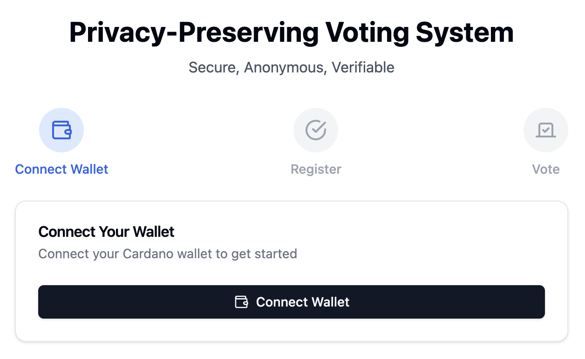

**Choose open ballot:**

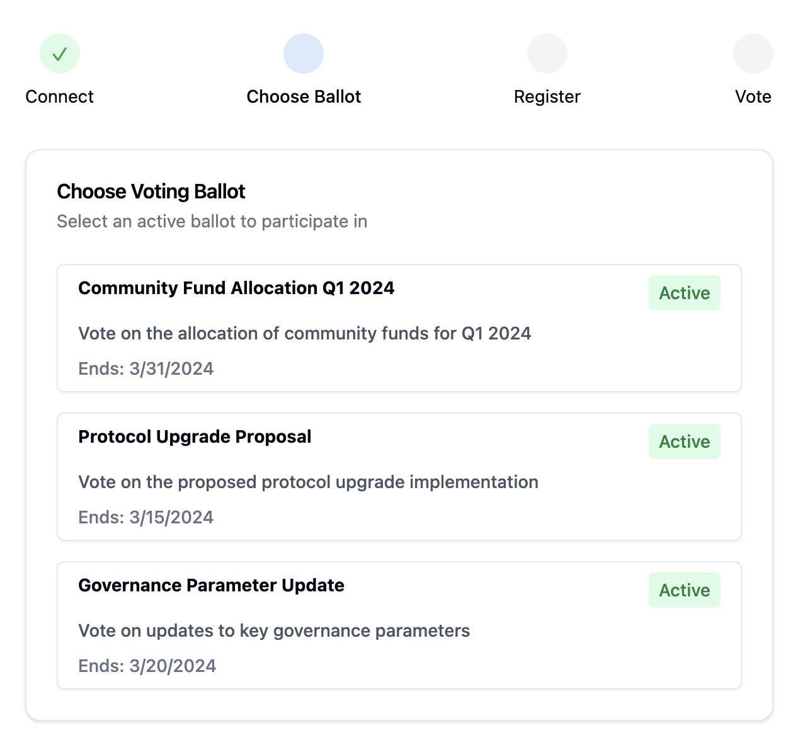

**Ballot Creation Template:**

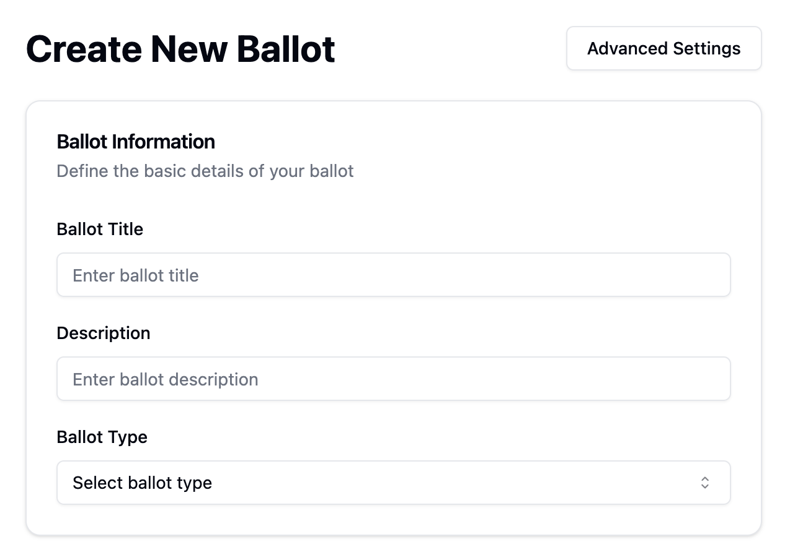

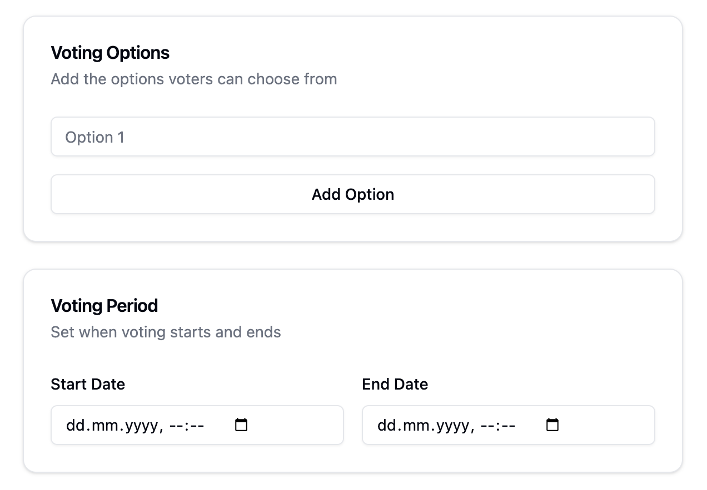

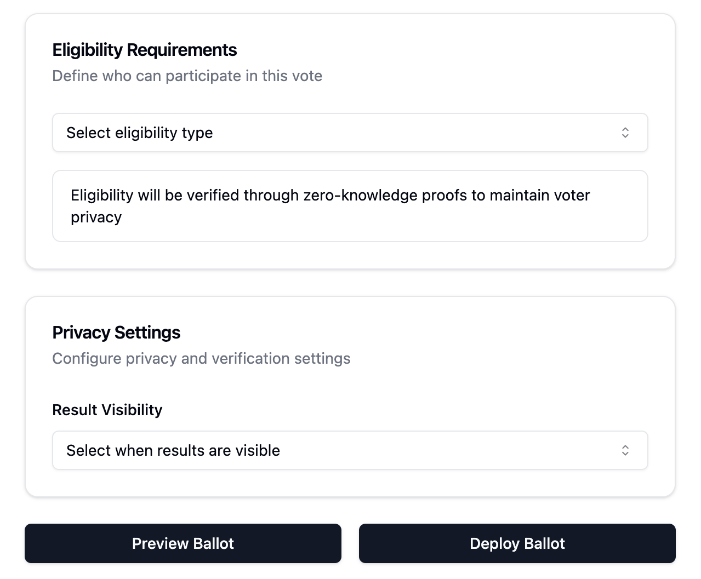

**Voter Registration Example:**

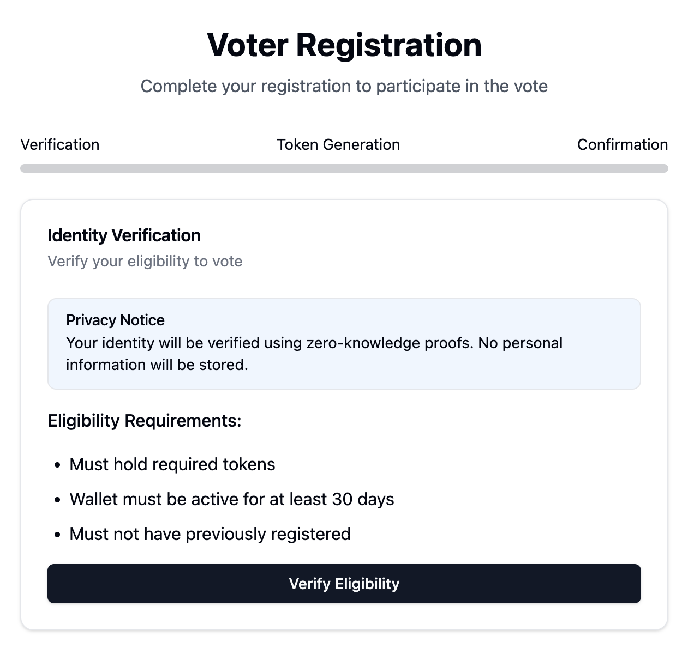

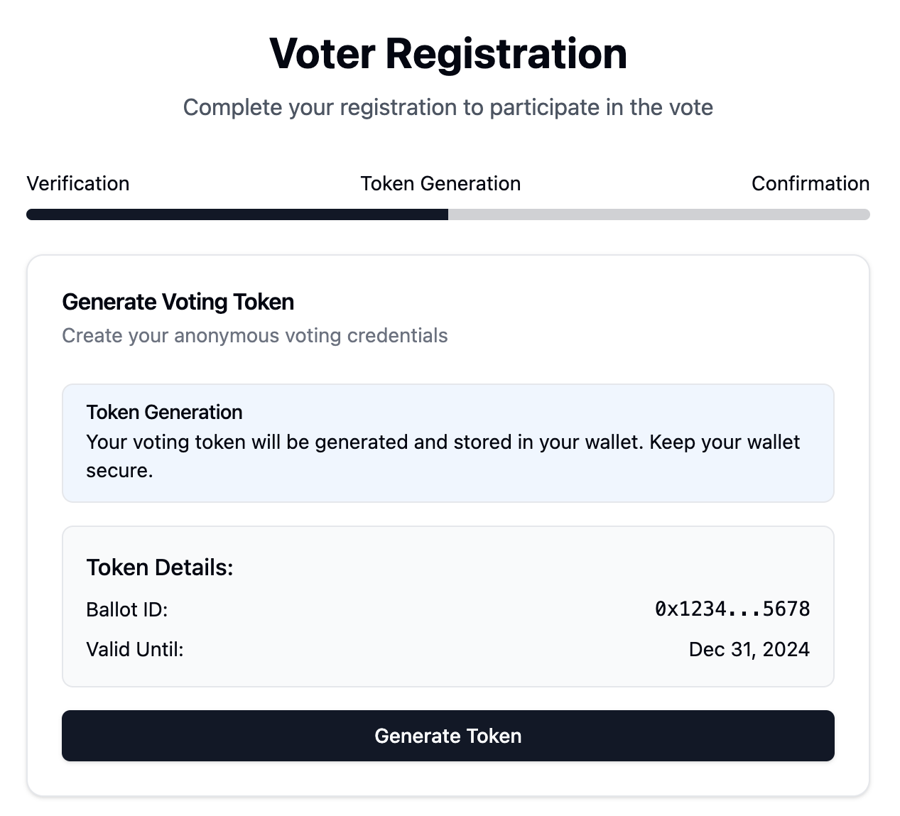

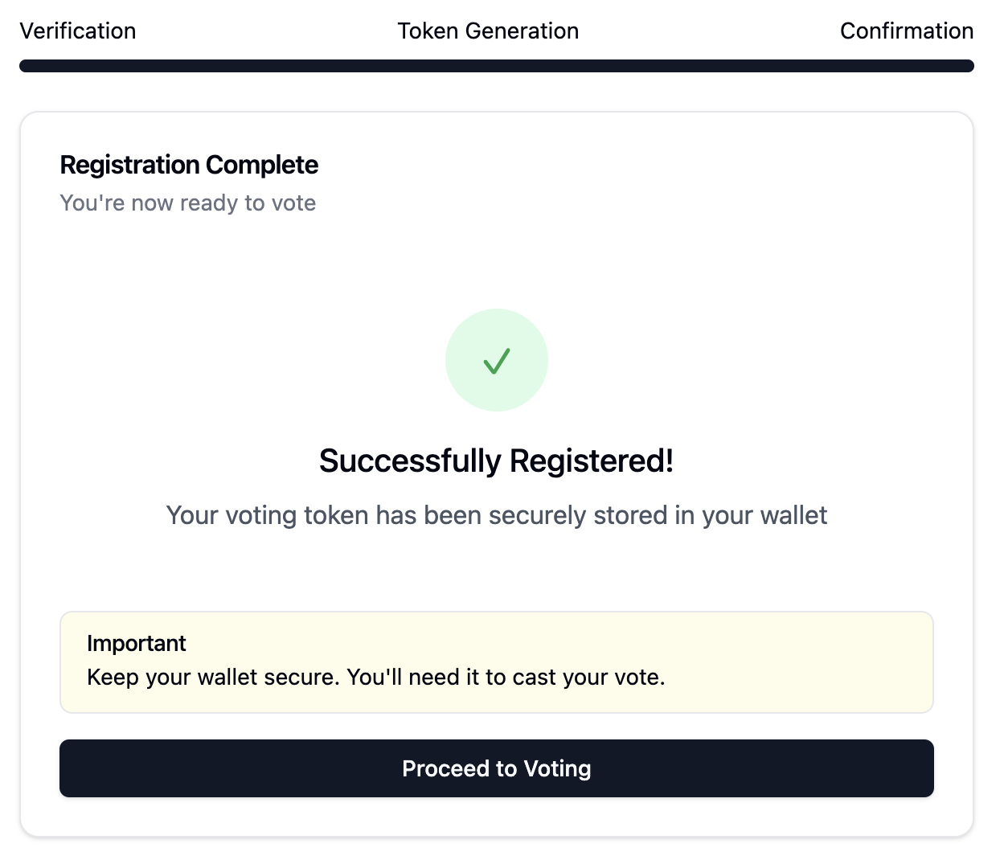

**Voting Example:**

Vote on the allocation of community funds for Q1 2025

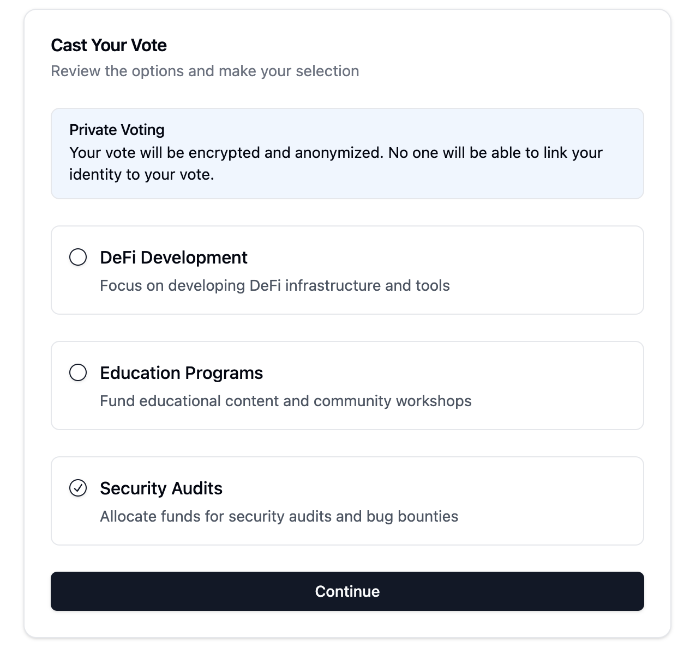

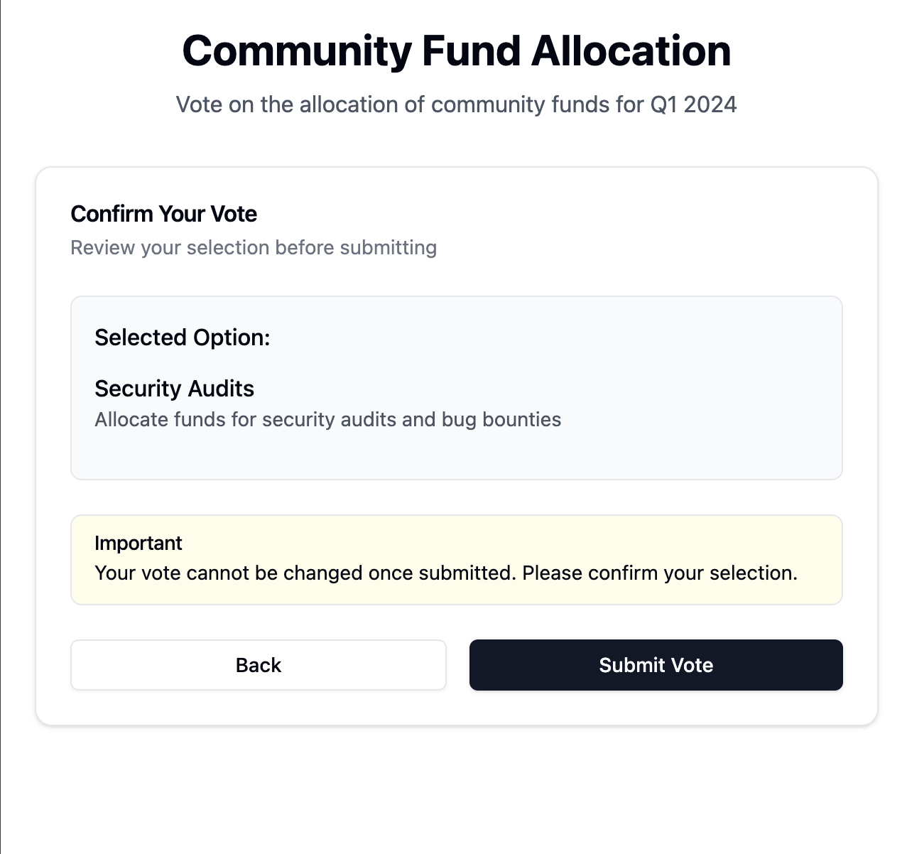

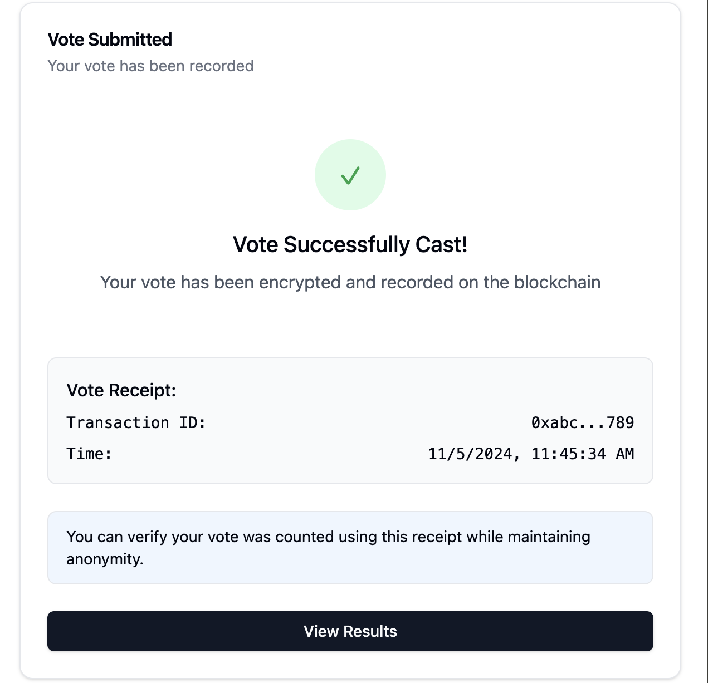
